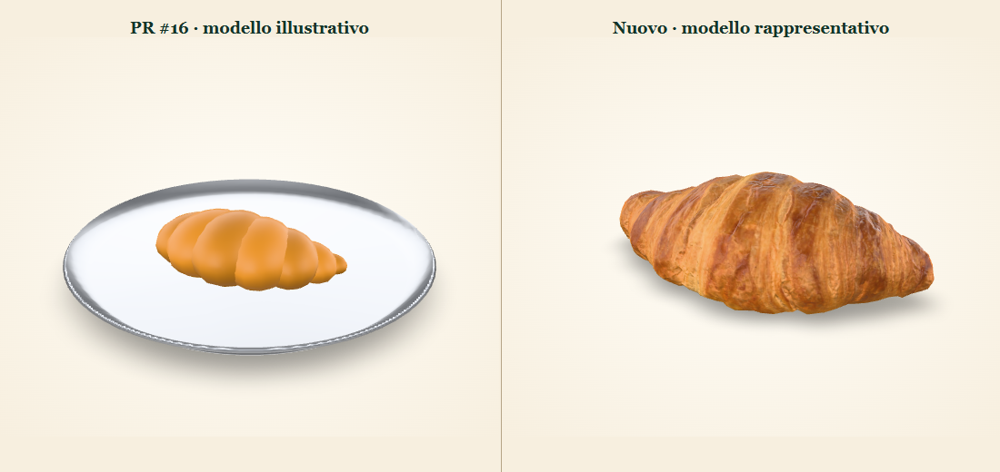
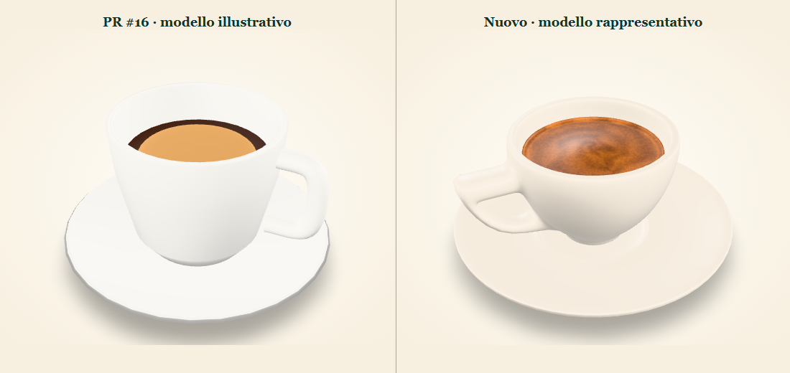
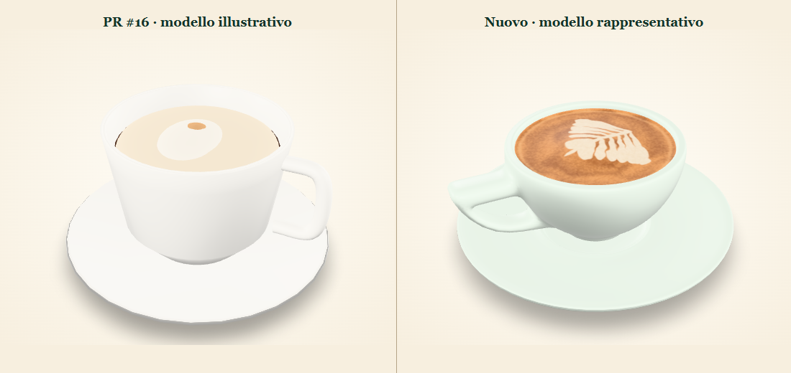

# Il Chiosco menu in 3D and AR

## Audit of PR #16

[PR #16](https://github.com/nourabm33/il-chiosco-/pull/16), merged as `db5c54c`, added 112 photo mappings and 112 procedural GLB/USDZ pairs. The homepage combines static product rows with cocktail cards rendered by `js/cocktails.js`. The table QR opens the browse-only `order.html` menu, which fetches `/api/menu` and falls back to the same checked-in 112-item catalog. Both entry points already use the same viewer.

- The old viewer used Google model-viewer and lazy-loaded the library, but inferred model URLs from every slug and advertised 3D on all items. The procedural Three.js generator used simplified shapes and materials for food, glass and packaging. Its default output directory could overwrite a replacement.
- The AR paths were already configured for WebXR, Android Scene Viewer and Apple Quick Look. Automatic resizing allowed departures from real scale. The AR button could appear before a model was usable and there was no handling for a failed AR launch, a model fetch error or a stalled load.
- The photo catalog includes café photos, stock references, existing drinks-card images and shared packaging photos. The Windspiel row uses the Giolu Gin image and needs its own verified reference. The inventory records these limitations per slug.
- The new viewer uses reviewed per-product paths, progress with an 18-second deadline, a photo fallback, a native dialog with keyboard focus handling and an AR button gated on model load and platform detection. Photos remain available for the 109 items pending replacement. The backend, catalog data, reservations and order flows are outside the change.

## Models in this PR

All three are marked **representative** in the viewer and inventory. Measurements are in meters in the manifest and correspond to the modeled object. The café should confirm its own serving sizes.

| Product | What changed | Size (width × height × depth) | GLB / USDZ |
| --- | --- | --- | --- |
| Croissant lievito madre vuoto | [Poly Haven Croissant](https://polyhaven.com/a/croissant) by Greg Zaal and Dario Barresi, CC0. The photogrammetry mesh retains its color, roughness and normal maps. The export is recentered and packed for mobile. | 20.0 × 6.2 × 7.55 cm | 0.86 / 0.95 MB |
| Espresso | Adapted [Cup of Coffee](https://sketchfab.com/3d-models/cup-of-coffee-f82264218618431d81b8a280076a786e) by senorp3dro ([CC BY 4.0](https://creativecommons.org/licenses/by/4.0/)), obtained through [Objaverse](https://huggingface.co/datasets/allenai/objaverse). The cup and saucer were resized, the fill lowered and the crema and ceramic materials authored for this product. | 11.6 × 5.08 × 11.6 cm | 1.05 / 0.77 MB |
| Cappuccino | Adapted the same licensed cup and saucer base into a larger service with a different glaze, higher fill, microfoam surface and hand-drawn rosetta. | 14.3 × 5.59 × 14.45 cm | 1.06 / 0.78 MB |

### Before and after

These are browser captures of the actual GLBs with the same lighting. The camera frames each model independently.

**Croissant**

**Espresso**

**Cappuccino**

## Production workflow

1. Confirm the slug and serving presentation with the café. Record measured width, height and depth of the product as served, including any plate, stem, glass, garnish or packaging. Keep source credits and confirm that licenses allow redistribution and adaptation for the public menu.
2. Scan stable, opaque foods from overlapping photos. In Blender or an equivalent DCC, remove the capture surface, close missing areas, simplify the mesh and bake albedo, roughness and normal maps. Use measured geometry for reflective or translucent glass, liquid, ice and cutlery. Use separate close-up references for foam, crema and packaging. Review glasses and liquid in each target renderer since their material support differs.
3. Set the source scene in meters. Bake transforms and position the base at Y=0 with X and Z centered in the glTF export. Make the matching USD stage Y-up at one meter per unit. Inspect under neutral lighting at several angles.
4. Export a self-contained GLB with JPEG/PNG textures and mobile geometry. Keep texture resolution at 2K or less and aim for a few MB per file. Check [Scene Viewer format limits](https://developers.google.com/ar/develop/scene-viewer#file_requirements_for_models) and use core metallic/roughness materials where possible. Export a USDZ with its own materials and bundled textures, preferably USDC packed by OpenUSD. Check package alignment and confirm it opens in the target Apple renderer. [Apple USD asset guide](https://developer.apple.com/documentation/usd/creating-usd-files-for-apple-devices)
5. Save both reviewed files as `assets/models/realistic/<slug>.glb` and `assets/models/realistic/<slug>.usdz`. Add the source, credit, license, dimensions and validation state to `tools/models/replacements.json`. Run `node tools/models/media.mjs` to update the browser manifest and inventory. Pending rows continue to show the photo. The offline `npm run build` legacy generator writes to the ignored `tools/models/output/legacy/` folder.
6. Run the automated checks below and record real-device results per model before claiming that table placement has been verified. Keep alternate variants under their own slugs.

### Capturing the remaining products

- **Pastries and brunch.** Shoot the actual serving against a matte, neutral surface with soft, even lighting. Keep lens, focus, exposure and white balance fixed. Take 25–35 overlapping photos around the product from each of two elevations, plus overhead and low side views. Include a ruler or measured reference next to the plate in a setup shot and record dimensions separately. For the focacciona, include both ends, fillings, cut face, the wrapper and side of chips if served together. The café's cinnamon roll photo shows a portion with cream, so a generic glazed spiral would misrepresent it. Capture the cinnamon roll as plated, and capture the toppings and bread edge on the avocado toast.
- **Coffee, matcha and cocktails.** Supply full side, overhead, 45-degree and back views of each served drink. Include the actual glassware profile, diameter, rim and fill height. Photograph foam, ice, citrus, flowers or other garnishes closely and record the recipe variant. Use photos as material references and model reflective glass against measurements, ideally with separate empty-glass references. Capture quickly after plating or pouring.
- **Packaged products.** Confirm exact bottle or can size, front and back label artwork and permission to use it. Glass or packaging photos for another brand are not sufficient.
- **Unidentified drinks.** The blue latte with flowers (`19.54.39 (3).jpeg`) and foam/cocoa/wafer drink (`19.54.40 (3).jpeg`) remain unmapped. Confirm their menu names and slugs before assigning either photo.

The initial benchmark products still awaiting models are matcha latte, cinnamon roll, avocado toast, focacciona, spritz and a signature cocktail. The [full inventory](MENU-MEDIA-INVENTORY.md) lists every other pending product.

## Automated verification

- `npm ci --prefix tools/models` then `npm run verify --prefix tools/models` checks all 112 media mappings, GLB structure, embedded resources, size, triangle limits and ground-centered bounds. All 107 unique photos decoded successfully over the preview subpath.
- Install OpenUSD Python bindings with `python -m pip install usd-core`, then run `python tools/models/verify-usdz.py` for USD stage and shader validation, texture resolution within the package, format, scale, ground alignment and dimensions. All six published files passed.
- Chromium desktop and a 320 px mobile viewport exercised the homepage, QR menu, lazy requests, 3D rotation and zoom, photo switching, unsupported AR, GLB failure, load timeout, opening another product during a stalled load and keyboard dismissal. AR handoff arguments and error handling were exercised with a simulated activation in Chromium.
- The 15 existing server integration tests passed against a fresh UTF-8 PostgreSQL database seeded with 112 products. The 40 QR routes passed the local subpath check. Server lint passed.

## Real-device verification — NOT VERIFIED

Use an HTTPS staging preview of **this PR branch**. The production GitHub Pages URL serves the merged branch. Serve `index.html`, `order.html`, and both model formats at the same subpath. Make model URLs directly reachable without a browser login, so Scene Viewer and Quick Look can fetch them.

1. On an **ARCore-compatible Android phone**, open the staging homepage in Chrome. Open each of the three 3D products and tap **Vedi sul tuo tavolo**. Allow camera access. The normal path is WebXR. To isolate Scene Viewer on the staging page, set the active model-viewer element's `ar-modes` to `scene-viewer` in remote DevTools and tap the on-page button again.
2. On an **iPhone with AR Quick Look**, use Safari. Repeat with each product. Quick Look should open its own USDZ. Select the AR view if the app starts on the Object tab and allow camera access.
3. Slowly point the camera at a well-lit textured table, then place the item. Walk around it. Check that the correct asset stays anchored on the tabletop, rests flat, can be moved, and matches the manifest dimensions against a ruler. Attempt to resize and verify the runtime respects the fixed-scale setting. Return to the menu and open another product to check for stale state.
4. Repeat from the staging table menu at `/order.html?table=12` or the backend's `/order?table=12`. Confirm table 12 stays selected, photos still open, and a pending item does not offer AR. Repeat in English.
5. On an unsupported browser, confirm the 3D preview remains usable. Native Scene Viewer may offer its own 3D fallback on some Android phones. The browser can detect a possible Scene Viewer handoff, while ARCore availability and camera access are decided by the native app.

Record phone, OS/browser version, model slug, path (WebXR/Scene Viewer/Quick Look), camera launch, placement, scale, movement and exit for each test. The integration uses [model-viewer AR capabilities and modes](https://modelviewer.dev/examples/augmentedreality/) and [Apple AR Quick Look](https://developer.apple.com/quick-look/).
