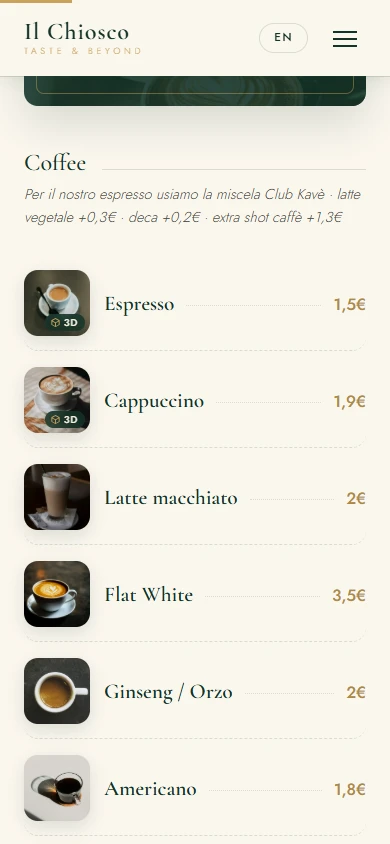
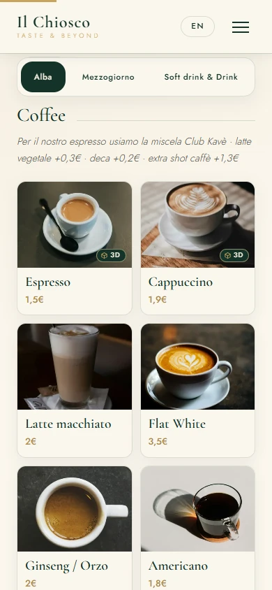
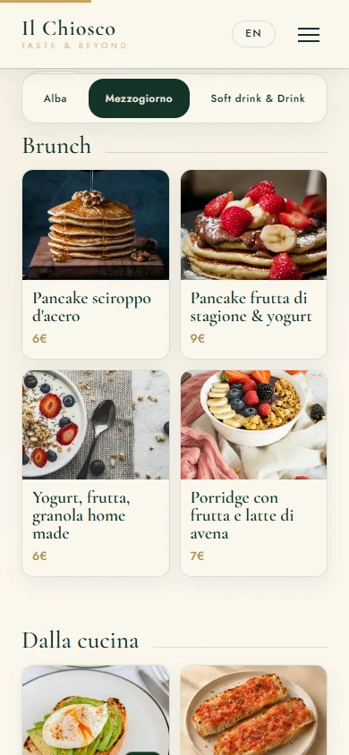
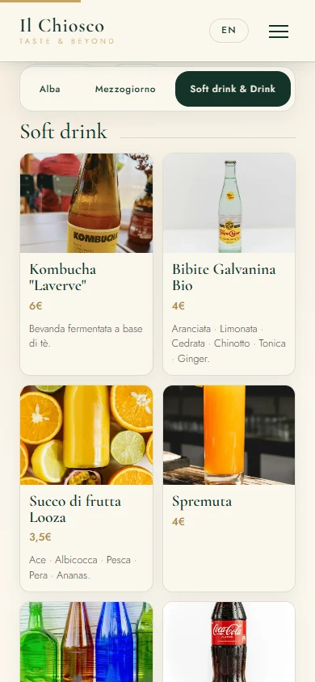
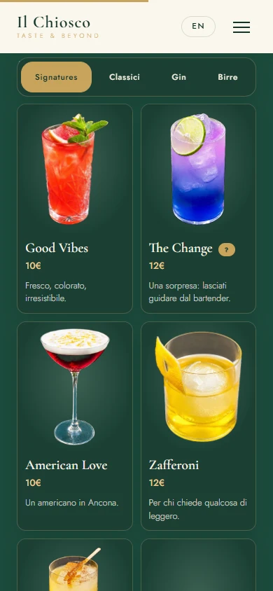
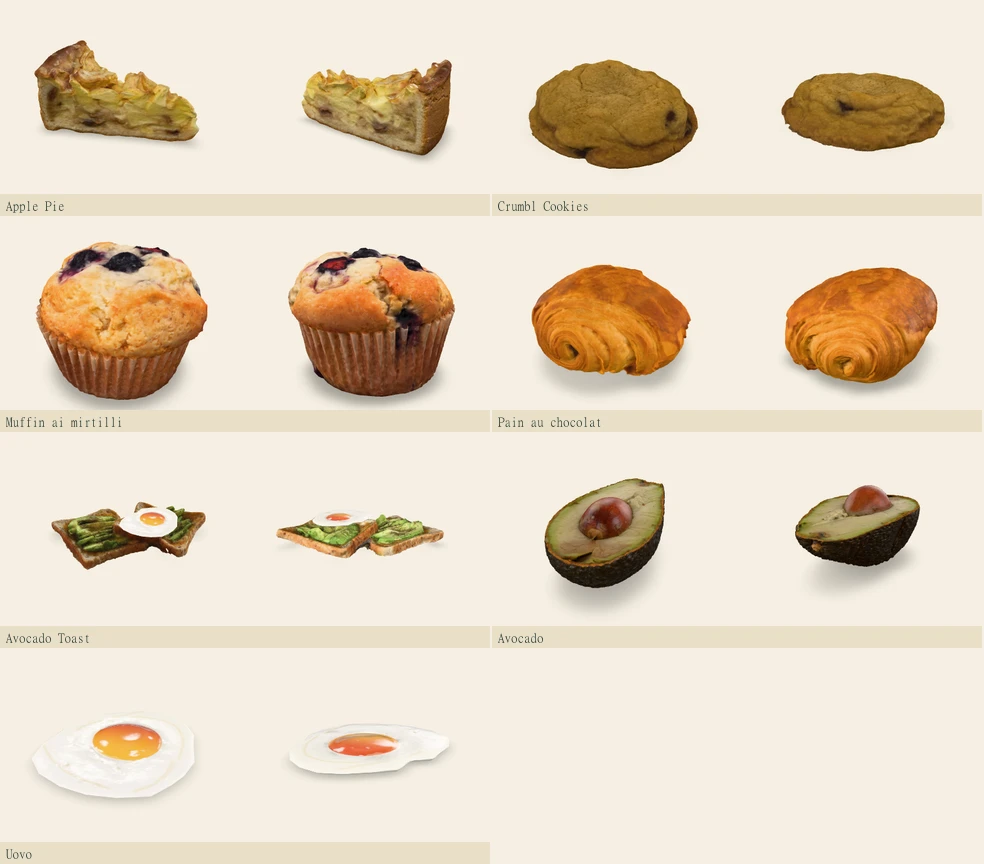

# Premium digital menu review

This update covers the public food and cocktail menus. The cards use responsive photography, product prices and a 3D indicator when the product has reviewed models. The category bar stays below the site header, and the food menu includes links to its subsections. The product viewer supports browsing the active menu panel, resetting the camera and switching between the photo and 3D.

The two existing Forst draft sizes now appear as separate cards. Their names, prices and slugs come from the existing catalog. The source catalog and all product descriptions are unchanged.

## Coverage

| Check | Result |
| --- | ---: |
| Catalog rows and public product cards | 112 / 112 |
| Products with a viewable photo | 112 / 112 |
| Products with a newly optimized thumbnail | 74 / 112 |
| Replaced product images | 8 |
| Products with a reviewed representative 3D model | 10 / 112 |
| Products with validated GLB and USDZ files | 10 / 112 each |
| Products with a rendered 3D preview and checked AR asset routing | 10 / 112 |
| Products tested with physical phone AR | 0 / 112 |

The [112-row inventory](MENU-MEDIA-INVENTORY.md) includes image sources and rights, remaining photo mismatches, model provenance, serving assumptions, dimensions and AR status. A photo mapping means the image is available. Some original stock and packaging references are still representative or unverified. The viewer labels the six generated images as representative.

The seven newly reviewed models are Apple Pie, Crumbl Cookies (a classic cookie representation), the blueberry muffin variant, Pain au chocolat, Avocado Toast, Avocado and Uovo. They join the three assets from PR #17. Each uses a separate model pair with a bottom-centered origin and dimensions in meters. The models and size estimates represent a serving. The café's exact portion and presentation can vary.

## Before and after

| At 390 px | PR #17 | This branch |
| --- | --- | --- |
| Coffee section |  |  |

The category examples show the public menu at the same mobile viewport.

| Alba | Mezzogiorno | Soft drinks | Cocktails |
| --- | --- | --- | --- |
|  |  |  |  |

The [320 px viewer capture](premium-menu-review/viewer-320.webp) shows the layout with simulated AR availability in Chromium.

## Sources and repeatable workflow

- Six representative images were generated with the built-in ImageGen tool and are stored under `assets/img/menu-renders/`. The prompts used warm ivory pottery or a clear glass, a cream café surface, soft daylight and a square editorial composition. The subjects were matcha and purple ube milk with ice, smoked salmon slices, the club sandwich with turkey and roasted potatoes, pan de cristal with tomato and herbs, the fried eggs and espresso brunch option, and a split apricot-filled croissant. These renderings are labeled in the menu. They depict the published description or the named variant.
- Two reference images were replaced with photographs of the correct package type from Wikimedia Commons. Both photographers released their work into the public domain. The files were resized and converted to WebP. The packaging dates are recorded in the inventory. [Coca-Cola Zero by Jorge Barrios](https://commons.wikimedia.org/wiki/File:Coca_Cola_Zero_bottle.png) · [Forst 1857 by Phyrexian](https://commons.wikimedia.org/wiki/File:Forst_1857_001.jpg)
- Candidate meshes were retrieved through [Objaverse](https://huggingface.co/datasets/allenai/objaverse) and cross-checked against the original creator pages. The [inventory](MENU-MEDIA-INVENTORY.md) credits each original under [CC BY 4.0](https://creativecommons.org/licenses/by/4.0/) and records the derivative. Avocado Toast combines the licensed toast scan and a separately credited fried egg.
- Run `npm ci --prefix tools/models` and `npm run media --prefix tools/models` to regenerate the image manifest and its 384 px WebP thumbnails. Shared source images share a thumbnail. When original photo rights are unverified, the existing public image is used directly.
- Stage a new GLB with `node tools/models/prepare-glb.mjs /path/source.glb model-slug width-in-meters [pitch-degrees] [yaw-degrees]`. The script writes to `tools/models/output/staged/`. It normalizes materials, budgets large meshes, embeds and resizes textures, and bakes the ground-aligned transforms. Check the model from above, the side and the back before promoting it. The packaged USDZ is built as a Y-up USDC stage with embedded textures. Add both files, the source and the measured or estimated dimensions to `tools/models/replacements.json`, then regenerate the manifest.

## Verification and performance

- `npm run verify --prefix tools/models` checks the 112 media mappings, thumbnails, embedded GLB textures, nonempty geometry, triangle and material budgets, and the scale and origin of every published GLB.
- `python tools/models/verify-usdz.py` with OpenUSD checks that each USDZ is aligned, self-contained and matches its GLB dimensions. Model transforms are baked so the native renderer sees a tight, ground-aligned bound.
- Chromium checked all product slugs and image URLs, the 10 interactive models, and the corresponding GLB/USDZ URLs and fixed-scale settings using simulated AR handoffs. The browser checks covered 1360 px, 390 px and 320 px widths, language switching, keyboard category navigation, the camera reset, product switching, focus return and photo fallback. The baseline and updated local previews both emitted the existing missing favicon request. The injected GLB failure showed the photo and the next product opened normally.
- The site makes zero 3D model requests on initial load. When the user selects a product, the viewer loads that GLB. It caps its in-memory model cache at two. For photos with verified provenance, cards use smaller thumbnails and the viewer loads the original on demand. The published GLBs range from about 0.18 to 3.23 MB. The USDZ files range from about 0.19 to 3.11 MB. In the local Chromium smoke test, the first model loaded in roughly 0.38–0.55 seconds after the click. Physical-device frame rate and memory use have not been measured.

## Device checks still required

On a compatible Android phone, open an HTTPS preview of this branch in Chrome and tap **Vedi in AR**. Test WebXR and Scene Viewer with the appropriate supported configuration. On iPhone, use Safari and test Quick Look. Repeat for every published model. Confirm that the correct product appears, the camera opens, the object rests on a detected horizontal surface, scale is plausible against a ruler, and the item stays anchored while you move. On an unsupported device, check that photo and 3D remain usable.

## Remaining asset work

The other 102 products keep their images. Twenty-five source models were inspected from two angles. Rejected candidates included scans with surrounding tables or warped plates, different toppings and flat drink materials. The trial for cinnamon roll blended the pastry and cream into its plate. A second local TripoSR trial did not extract a surface from the vegan croissant reference. The hosted Good Vibes trial was unable to export because the free GPU quota was reached.

This machine has 4 GB of GPU memory. The documented local TRELLIS.2 pipeline requires 24 GB, and the hosted free service has a daily quota. Tencent Hunyuan3D-2's license excludes the European Union. A high fidelity reconstruction pipeline with adequate compute, or more suitable commercial-use source meshes, is needed to complete the remaining variants. Branded packaging requires separate clearance for any label embedded in a new 3D asset. [TRELLIS.2 requirements](https://github.com/microsoft/TRELLIS.2#prerequisites) · [ZeroGPU quotas](https://huggingface.co/docs/hub/en/spaces-zerogpu) · [Tencent license](https://github.com/Tencent-Hunyuan/Hunyuan3D-2/blob/main/LICENSE)
